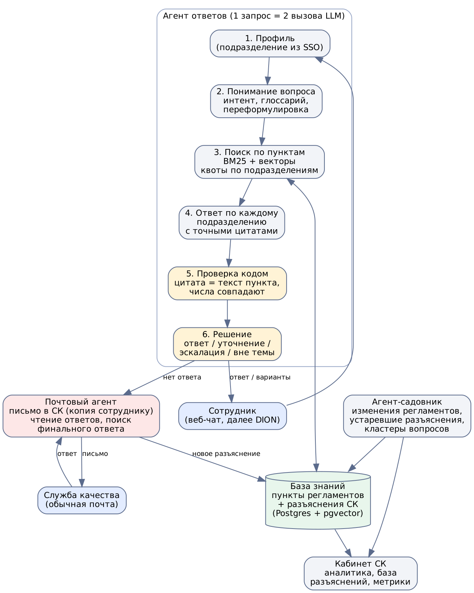

# MORE TECH · Агент ответов по регламентам

ИИ-агент, который отвечает сотрудникам на вопросы по корпоративным регламентам **строго по тексту документов**.
Каждое утверждение ответа опирается на дословную цитату пункта, совпадение цитаты и чисел проверяет код, а не
нейросеть. Если ответ зависит от подразделения, агент уточняет. Если ответа в регламентах нет, он отправляет письмо
в службу качества, сам находит в переписке финальный ответ эксперта и пополняет базу знаний.

Решение для хакатона «ИИкузница» (трек «Аналитик данных», задача Softline «Поиск ответов по корпоративным документам»).



## Три сценария заказчика

| Сценарий | Что делает агент |
|---|---|
| **Ответ есть в регламенте** | Короткий ответ простым языком + пункт регламента + раскрывающаяся дословная цитата и ссылка на пункт. Видны время и стоимость ответа |
| **Ответ зависит от контекста** | Подразделение - из вопроса, диалога или профиля (имитация SSO). Если неизвестно и правила разные - кнопки только с подразделениями, где ответ есть, плюс «Не знаю - показать все» и «Комплексный проект». После выбора ответ **мгновенно и без вызова модели**. Не больше 2 уточнений |
| **Ответа нет** | Честно говорит, что правила нет, подсвечивает документы, на которые ссылается регламент, но которых нет в базе. По клику сотрудника - письмо в службу качества (сотрудник в копии). Почтовый агент находит финальный ответ эксперта (права отправителя, метки `#ответ`/`#черновик`, владелец процесса в копии) → разъяснение в базе знаний → на похожий вопрос агент отвечает сам, со ссылкой на разъяснение |

Дополнительно: вопросы вне регламентов (премия, маржа) → «к руководителю»; посторонние задачи - отказ; противоречие
внутри регламента - не выбирает сам; два эксперта ответили по-разному - оба ответа с пометкой до решения службы
качества; изменился пункт регламента - связанные разъяснения уходят на перепроверку.

## Почему ответу можно верить

1. **Модель находит и формулирует - код проверяет и решает** ([ADR 0001](docs/adr/0001-evidence-verification.md)).
   Утверждение без дословной цитаты, с чужим пунктом, с числом или единицей срока, которых нет в цитате, к сотруднику
   не попадёт. Правило без второго условия или исключения («только после подписания договора *и при наличии оплаты*»)
   код находит и возвращает модели на исправление; не исправила - показывается предложение регламента целиком.
2. **Уточнение по правилу, а не по настроению модели** ([ADR 0003](docs/adr/0003-clarification-rule.md)).
3. **Поиск видит все подразделения** - квоты, а не общий top-k ([ADR 0002](docs/adr/0002-search.md)).
4. **Качество измерено**: 76 вопросов в 10 категориях на настоящих регламентах, независимый проверяющий -
   более крупная модель Qwen3.5-122B-A10B. Отчёт с замечаниями проверяющего - [evals/reports/latest.md](evals/reports/latest.md).

| Метрика | Значение |
|---|---|
| Ложные ответы (выдуманное правило, неполный ответ выдан за полный) | **0%** |
| Честный неполный ответ (часть - с цитатой, недостающее названо явно) | **100%** |
| Верное поведение (ответ / уточнение / служба качества / отказ) | **100%** |
| Верный пункт в цитате | **98,2%** |
| Отсутствующие документы подсвечены | **100%** |
| Время ответа | медиана **6,0 с**, 95% - 11,3 с; после кнопки уточнения - мгновенно |
| Стоимость вопроса по ценам Alibaba Cloud | **0,21 ₽** (фактически через AI Tunnel - ~0,10 ₽) |

## Экономика

Один вопрос - в среднем 2,1 вызова модели (понимание вопроса + ответ по подразделению; если подразделение неизвестно,
ответы по подразделениям считаются параллельно), уточнение - 0 вызовов.
Стоимость по ценам официального провайдера модели и при локальном развёртывании - [docs/cost.md](docs/cost.md).
Модель - минимальная достаточная по метрикам ([ADR 0004](docs/adr/0004-model-choice.md)).

## Архитектура

```
skills/      скиллы агента: skill.yaml, промпты, схемы, проверки кодом, тестовая модель, тесты
  query-understand        тип вопроса, самостоятельная формулировка, поисковые запросы, подразделения
  answer-compose          ответы по подразделениям с цитатами; проверка кодом
  answer-verify           независимая проверка смысла второй моделью (строгий режим, эвалы)
  expert-reply-classify   финальный ли ответ в письме эксперта
  clarification-extract   разъяснение для базы знаний из переписки
  gap-cluster             темы вопросов без ответа для службы качества
sdk/         контракт скилла: вызов модели с проверкой схемы, учёт токенов и стоимости, тестовая модель
libs/        без модели: reg-parse (DOCX/HTML → пункты), evidence (цитаты, числа), ru-text (леммы, глоссарий),
             pii-guard (обезличивание ПДн перед вызовом модели)
passports/   паспорт компании: подразделения, глоссарий, служба качества, правила «вне базы», демо-профили
src/         приложение: адаптеры (LLM-шлюз, БД, почта, Confluence, эмбеддинги), агенты (ответов, почтовый,
             садовник), аналитика, API
web/         чат сотрудника и кабинет службы качества (React + TypeScript)
evals/       тестовый набор и прогон с метриками
deploy/      Docker Compose: приложение, PostgreSQL, Caddy (HTTPS), профиль local-llm (vLLM)
docs/        архитектура, решения (ADR), стоимость, сторонние компоненты
```

Ядро агента не знает про конкретную компанию: всё компанийное - в паспорте. Подключить другую компанию - написать
паспорт и указать источник документов (папка DOCX или пространство Confluence).

## Запуск

```bash
cp .env.example .env                    # ключ модели, почта, домен
mkdir -p data/regulations && cp *.docx data/regulations/   # регламенты - отдельный том, в репозиторий не входят
docker compose --env-file .env -f deploy/docker-compose.yml up -d --build
# или на чистый сервер Ubuntu одной командой (Docker, зеркала образов, HTTPS):
curl -fsSL https://raw.githubusercontent.com/More02/moretech-reglament-agent/main/deploy/bootstrap.sh | bash
# своя видеокарта вместо облачного API:
docker compose --env-file .env -f deploy/docker-compose.yml --profile local-llm up -d
```

Разработка без сети и ключей (тестовая модель, хэш-эмбеддинги, почта в памяти):

```bash
uv sync --extra dev
LLM_FAKE=true EMBEDDINGS_BACKEND=hashing uv run reglament ingest
LLM_FAKE=true EMBEDDINGS_BACKEND=hashing uv run reglament serve
cd web && npm ci && npm run dev
```

Команды: `reglament ingest | serve | mail-poll | gardener [--send-digest] | eval [--fake] [--judge]`.

## Стандарты

Python 3.12+, mypy strict, ruff (линтер и формат), pydantic-модели с `extra="forbid"` для всех ответов модели,
pytest (в том числе тесты на выдуманные пункты, цитаты и числа), TypeScript strict, ESLint, Prettier, pre-commit
и CI (линтеры, типы, тесты, сборка образов, поиск секретов). Секреты - только в `.env`.

## Модели и компоненты

[docs/third-party.md](docs/third-party.md): Qwen3.6-35B-A3B и Qwen3.5-122B-A10B (Apache 2.0), BGE-M3 (MIT),
лицензии библиотек и раскрытие ранее созданных наработок.
