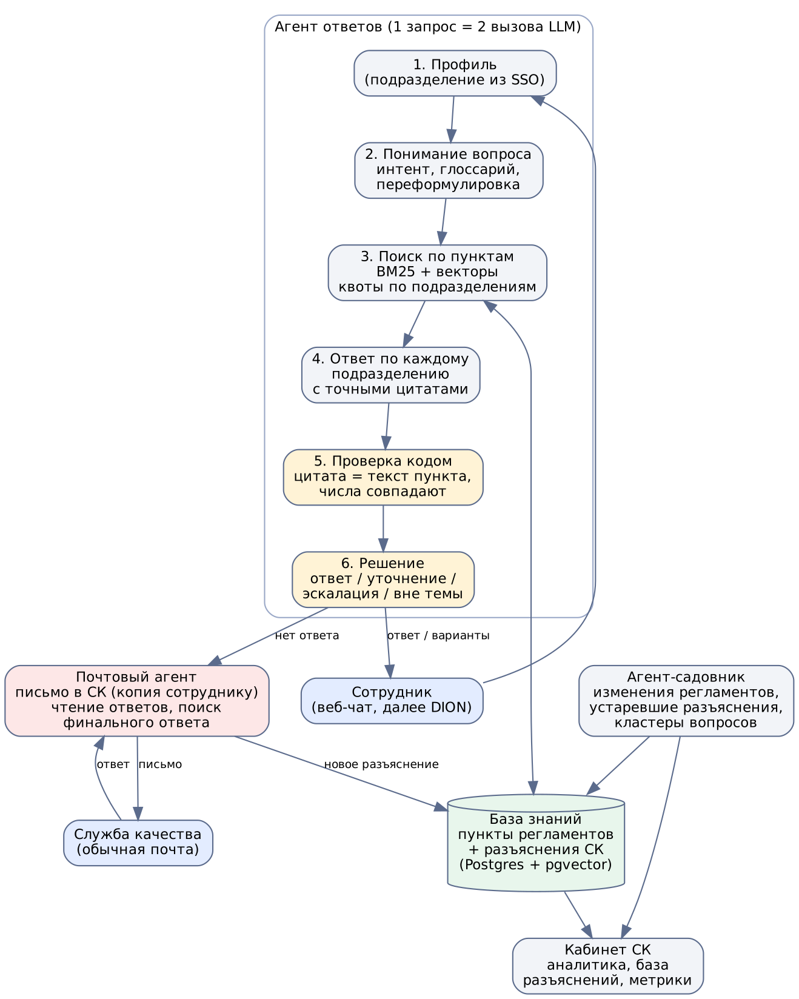

# Архитектура

## Принципы

1. **Модель находит и формулирует, код проверяет и решает.** Каждое утверждение ответа несёт номер пункта и дословную
   цитату; код сверяет цитату с текстом пункта и числа утверждения с цитатой. Неподтверждённое выбрасывается.
2. **Уточнение - по правилу, а не по настроению модели.** Пункты размечены фасетами (подразделение, стадия). Если ответы
   подразделений различаются, а подразделение сотрудника неизвестно, агент уточняет; варианты - только из найденного.
3. **Один вызов модели готовит ответы для всех подходящих подразделений.** После уточнения ответ отдаётся мгновенно.
4. **Ядро общее, компания - в паспорте.** Глоссарий, подразделения, адреса службы качества и правила «вне базы» -
   в `passports/<company>.yaml`.
5. **Скилл = манифест + промпты + схемы + проверки кодом + тестовая модель + тесты.** Скиллы не ходят в сеть и базу:
   всё приходит во входе и контексте.
6. **152-ФЗ:** персональные данные обезличиваются шлюзом до отправки во внешнюю модель и восстанавливаются в ответе.

## Агенты

| Агент | Что делает | Скиллы |
|---|---|---|
| Агент ответов | Профиль → понимание вопроса → гибридный поиск с квотами по подразделениям → ответы с цитатами → проверка → решение | `query-understand`, `answer-compose` |
| Почтовый агент | Письмо в службу качества, чтение переписки, поиск финального ответа, публикация разъяснения | `expert-reply-classify`, `clarification-extract` |
| Агент-садовник | Изменения регламентов → перепроверка разъяснений; группы вопросов без ответа → кандидаты на актуализацию | `gap-cluster` |
